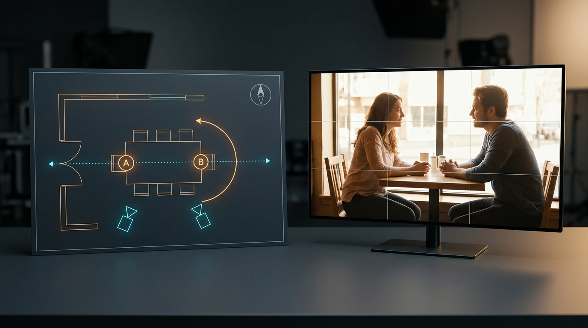
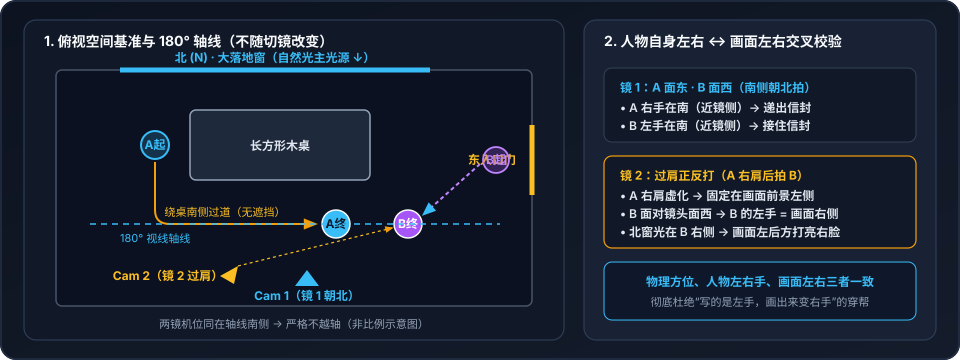
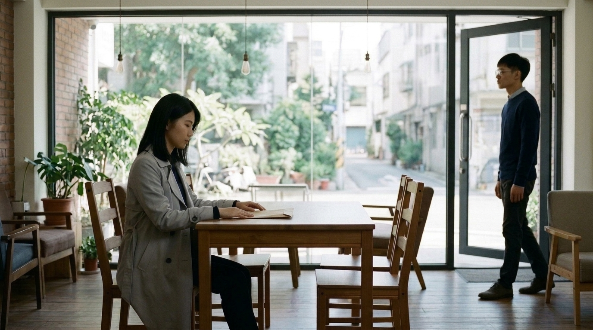
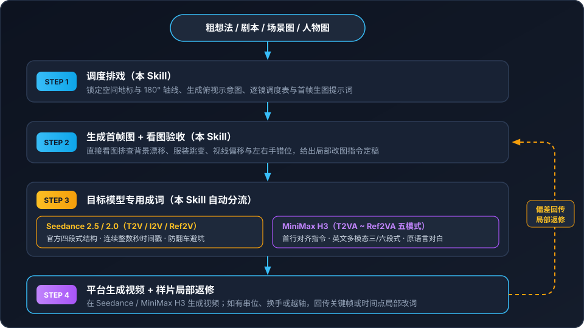

<p align="center">
  
</p>

<h1 align="center">Ai-Video-Blocking</h1>

<p align="center">
  <strong>AI 视频人物站位与镜头调度导演 Skill｜现场执行导演 + 场记 + 提示词工程师</strong><br/>
  把一句想法或剧本，拆成不穿帮的空间站位、180° 轴线、首帧生图词与 <strong>Seedance 2.5 / MiniMax H3</strong> 专用视频提示词。
</p>

<p align="center">
  
  
  
  
</p>

<p align="center">
  <strong>中文</strong> &nbsp;|&nbsp; <a href="README_EN.md">English</a>
</p>

> [!TIP]
> **🎬 进阶搭档 Skill 上线｜双剑合璧，从“空间不穿帮”升级到“真电影质感”**
> - **① 基础空间闭环（本仓库）**：**Ai-Video-Blocking** —— 锁死地标、站位走位、180° 轴线、左右手 ↔ 画面左右换算与 Seedance / MiniMax H3 标准出词。
> - **② 进阶电影感增强**：👉 **[Ai-Cinematic-Skill](https://github.com/demon820308/Ai-Cinematic-Skill)** —— 专攻剧本 5 要素审计、Meisner 潜台词与 FACS 微表情、离散 FOV 光学与 60/30/10 光色、硬核格斗物理、Hell-Grind 长片资产与 Seedance 15 类疑难翻车急救。
> - **一句话选型**：怕穿帮（串位/越轴/换手）先用本 Skill；嫌假（假演/平光/绵软打斗/长片漂移/疑难翻车）接 **[Ai-Cinematic-Skill](https://github.com/demon820308/Ai-Cinematic-Skill)**。

---

## 为什么需要这个 Skill？

用 AI 做多镜头剧情视频时，最常见也最烧抽卡成本的翻车往往不是“画质不够好”，而是**空间与连续性崩坏**：人物切一镜就串位、正反打视线对不上、道具无故换手、人物走着走着穿模或越轴。

本 Skill 把影视现场的**空间坐标系、人物朝向/视线分离、左右手与道具交接、180° 轴线规则、首帧看图验收**沉淀为可执行规范，并内置 **Seedance 2.5** 与 **MiniMax H3** 两大主流模型的专用提示词结构，帮你从“有一点想法”一路跑到“可直接粘贴出片”。

<p align="center">
  
</p>

---

## 可以做什么形式的内容？

只要画面核心是**「人在空间里演戏与互动」**，不限画风（写实、3D、2D 动漫、古装、现代）与画幅（16:9 / 9:16），都可直接上手：

- **AI 短剧 / 竖屏微短剧**：双人/多人对手戏、进门打断、递物、摊牌吵架、正反打对话。
- **AI 漫剧 / 剧情动画短片**：固定场景反复切镜，保持角色造型、地标方位与道具归属一致。
- **电影感微电影 / 悬疑短片**：走廊跟拍、一镜到底、合法跨轴、遮挡重入画、微表情反应镜。
- **情景剧情广告 / 品牌故事片**：有演员互动的连续剧情带货或品牌短片。
- **叙事向 MV / 情感短片**：人物走位情绪戏、擦肩而过、回眸对视与回忆切镜。
- **前期分镜预演（Previs）**：高成本制作前，先用俯视站位图 + 首帧样图验证机位、轴线与走位。

---

## 能力边界：能做什么 vs 不能做什么

| ✅ 可以做什么 | ❌ 不能做什么 |
| :--- | :--- |
| **粗想法 / 剧本 → 空间调度与拆镜**：自动补齐地标、站位、走位与轴线（补全项明确标为「调度补足假设」） | **不能直接渲染视频**：仅产出调度方案、提示词与修正指令，最终视频需在 Seedance / MiniMax H3 平台生成 |
| **输出首帧生图提示词**：定格静态瞬间 + 人物左右手 ↔ 画面左右防反校验 + 负面约束 | **不做长篇编剧策划**：擅长把已有剧情拍清楚，不负责写 30 集大纲或爆款爽点策划 |
| **按目标模型输出专用视频词**：自动分流 **Seedance 2.5/2.0** 四段式结构或 **MiniMax H3** 五模式多模态结构 | **不能保证 100% 一次抽卡零瑕疵**：能清掉逻辑与已知模型坑点，但视频模型本身仍有随机性 |
| **首帧图 / 样片看图验收与局部返修**：抓出背景漂移、服装跳变、视线偏移、左右手错位，只给局部改词指令 | **不适合纯空镜/静物/抽象特效**：无人物空间调度需求时，建议直接使用各平台的垂直风格 Skill |

---

## 实测效果展示（咖啡馆两镜正反打闭环）

以下两张首帧图由本 Skill 自动生成的**镜头 1 / 镜头 2 首帧生图提示词**直接渲染产出，展示了 **180° 轴线锁定、人物自身左右手 ↔ 画面左右换算、北窗光影一致** 的实际效果：

<p align="center">
  
</p>

| 镜头 1 首帧（中景｜南朝北建立空间） | 镜头 2 首帧（过肩近景｜林秋右肩后拍景川） |
| :---: | :---: |
|  |  |
| **空间基准**：北墙大落地窗在后景、东侧入口门在最右；林秋（浅灰风衣）坐西椅面东按桌面信封，景川（深蓝毛衣、细框眼镜）自东门步入面西。 | **跨镜不越轴**：林秋右肩在前景左虚化；景川在画面中偏右看左；**景川左手在画面右下稳握信封**；北窗光从画面左后方照亮景川右脸颊。 |

> **看图验收闭环示例**：将上面两张首帧图回传给本 Skill 做视觉验收时，它自动揪出了 4 处人眼易漏的细节（镜 1 桌周多余餐椅挡道、景川视线偏高、镜 2 背景黑框外门漂移为木框 EXIT 门、景川毛衣内搭衬衫领消失），并直接给出了**局部可替换的修图指令**，避免带着穿帮进视频生成阶段。

---

## 快速开始

### 安装与启用

```bash
# 方式一：通过 skills CLI 一键安装（推荐同时安装进阶搭档 Ai-Cinematic-Skill）
npx skills add https://github.com/demon820308/Ai-Video-Blocking
npx skills add https://github.com/demon820308/Ai-Cinematic-Skill

# 方式二：直接克隆到本地 skills 目录
git clone https://github.com/demon820308/Ai-Video-Blocking.git
git clone https://github.com/demon820308/Ai-Cinematic-Skill.git
```

### 双 Skill 怎么配合使用？

| 协作模式 | 适用场景 | 执行顺序 |
| :--- | :--- | :--- |
| **单场升格（`1 → 2`）** | 最常用：空间排稳了，但画面像 AI 假演/平光 | 先用 **Ai-Video-Blocking** 定站位、轴线与左右手 → 把结果贴给 **[Ai-Cinematic-Skill](https://github.com/demon820308/Ai-Cinematic-Skill)** 注入潜台词/FACS/FOV 光学/60-30-10 光色 |
| **长片三明治（`2 → 1 → 2`）** | 多场次短片/长片工业化制作 | 先用 **[Ai-Cinematic-Skill](https://github.com/demon820308/Ai-Cinematic-Skill)** 审剧本、建表演母版与灰底无头资产 → 再用 **Ai-Video-Blocking** 逐场排空间与首帧 → 最后用 **[Ai-Cinematic-Skill](https://github.com/demon820308/Ai-Cinematic-Skill)** 升格出词与翻车急救 |
| **各自独立使用** | 轻量剧情片 / 单项专项需求 | 只需防穿帮排戏 → 单用 **Ai-Video-Blocking**；只需特写微表情/格斗编排/空镜底图/15 类翻车急救 → 单用 **[Ai-Cinematic-Skill](https://github.com/demon820308/Ai-Cinematic-Skill)** |

> **同时安装时的调用技巧**：发话时在句首显式点名 `用 Ai-Video-Blocking`（排空间/轴线/左右手）或 `用 Ai-Cinematic-Skill`（升格电影感/表演/动作/长片资产/排错），触发最干净、互不打架。

保持 `SKILL.md` 位于文件夹根目录，并保留 `references/` 与 `templates/` 相对路径：

- **Antigravity**：将仓库文件夹放到 `C:\Users\<用户名>\.gemini\config\skills\`（macOS/Linux 为 `~/.gemini/config/skills/`），新开对话即可自动触发。
- **Claude Code / Cursor / Codex / 其他支持 Skill 的 Agent**：直接通过上方 `npx skills add` 安装，或克隆后导入为自定义 Skill 目录。

---

## 详细使用方法

### 1. 标准 4 步出片流程

<p align="center">
  
</p>

### 2. 直接填空就能发的输入模板

```text
请帮我做【几镜】连拍的站位调度和生图/生视频提示词（模式：I2V / Ref2V / T2V，目标模型：Seedance 2.5 / MiniMax H3）。

【场景与固定地标】
（例如：咖啡馆靠窗卡座，北墙大落地窗，东侧入口门，窗边长方形木桌，东西两侧各一把木椅）

【出场人物与造型】
- A（角色名）：性别、发型、服装颜色、配饰（如有参考图请直接上传）
- B（角色名）：……

【逐镜剧情、道具与时长】
- 镜头1（X秒，景别）：起拍状态 → 谁先动 → 经过哪个地标 → 哪只手拿/递什么道具 → 结束状态
- 镜头2（X秒，景别/正反打）：接上一镜 → 动作与视线变化 → 落幅状态
```

### 3. 常用控制口令速查表

| 你想做什么 | 直接在消息里加上这句 | Skill 的执行行为 |
| :--- | :--- | :--- |
| 先评估可行性，防踩坑 | `先分析，先别出提示词` | 只做素材盘点、硬冲突拦截与风险分析，不出词 |
| 坚持一镜到底 | `必须单镜头一镜到底，不要拆镜` | 不擅自拆镜，说明风险并给减负后的稳妥单镜版 |
| 指定模型与模式 | `用 Seedance 2.5 按 I2V 写词` / `用 MiniMax H3 按 FL2VA 输出` | 自动加载对应模型结构规范，或同时输出两家对比版 |
| 只要局部某一项 | `只给我俯视示意图和走位路线` / `只要视频提示词` | 只交付指定模块，不强行输出全部 A–E 大表 |
| 看图 / 样片返修 | `帮我做首帧验收和跨镜连续性检查，给局部修正指令` | 逐项定位偏差，只给局部可替换指令与复看核对点 |

---

## 目录结构

```text
Ai-Video-Blocking/
├── SKILL.md                               # 核心角色、原则、按需读取路由与执行流程
├── README.md                              # 中文说明与效果图
├── README_EN.md                           # 英文说明
├── assets/                                # README 展示素材
│   ├── hero-cover.jpg                     # 仓库头图
│   ├── pain-points-zh.svg / en.svg        # 4 大高频翻车 vs 解法对比图
│   ├── blocking-axis-zh.svg / en.svg      # 俯视站位 + 180° 轴线 + 左右手换算图解
│   ├── workflow-zh.svg / en.svg           # 4 步出片流程图
│   ├── demo-shot1-keyframe.jpg            # 实测镜头 1 首帧图
│   └── demo-shot2-keyframe.jpg            # 实测镜头 2 首帧图
├── references/                            # 按需加载的细则与模型规范（渐进披露）
│   ├── 01_人物身份与造型锁定.md
│   ├── 02_场景空间坐标与地标.md             # 含可动地标（门窗/抽屉）把手-转轴三元组约束
│   ├── 03_走位动作与道具连续性.md
│   ├── 04_摄影机与镜头轴线.md             # 含「人物自身左右 ↔ 画面左右」换算校验
│   ├── 05_镜头连续性与拆镜.md
│   ├── 06_样片验收与偏差修正.md             # 含声画时序/音效同步偏差分类
│   ├── 07_Seedance提示词结构规范.md        # 火山方舟 Seedance 2.5（兼 2.0）官方结构与避坑
│   └── 08_MiniMax_H3提示词结构规范.md      # MiniMax H3 五模式专用结构与三类物理音效声画同步规范
└── templates/                             # 按需加载的交付模板
    ├── 站位与走位方案模板.md
    ├── 首帧生图提示词模板.md
    ├── 视频生成提示词模板.md              # 含「精简执行版」与「分秒场记版」
    └── 样片检查表.md
```

---

## 版本说明

- **V1.0**：建立人物身份锁定、空间坐标、走位与道具连续性、摄影机与轴线、动作复杂度拆镜及样片验收完整框架。
- **V1.1**：在 `SKILL.md` 新增按需读取路由表实现渐进加载；优化触发描述与非适用边界；补充「人物自身左右 ↔ 画面左右」交叉核对规则；聚焦 T2V / I2V / Ref2V 主流工作流并精简低频分支。
- **V1.2**：内置 **Seedance 2.5（兼 2.0）**（`references/07_Seedance提示词结构规范.md`）与 **MiniMax H3**（`references/08_MiniMax_H3提示词结构规范.md`）两大主流视频模型专用结构规范，完善 GitHub 文档与实测配图，形成「调度排戏 → 首帧验收 → 目标模型专用成词」一站式闭环。
- **V1.3**：新增三类物理音效声画同步规范（瞬态接触音防抢跑、持续/周期过程音绑定起止、环境底噪/画外音防串源及双栏严格同序），并同步补齐 `SKILL.md` 交付前预演清单与样片验收声画时序检查项。
- **V1.4**：新增可动地标机构约束（条件触发），覆盖单扇/双开/推拉门窗与抽屉的参考图把手反推、「把手侧 + 转轴侧 + 开合方向」三元组锁定、切镜反打画面左右换算与扫掠区防撞，同步补齐首帧模板、H3（I2VA/FL2VA/Ref2VA）、交付前预演清单与样片验收偏差分类，根治把手留在转轴侧而门从反侧打开的穿帮。
