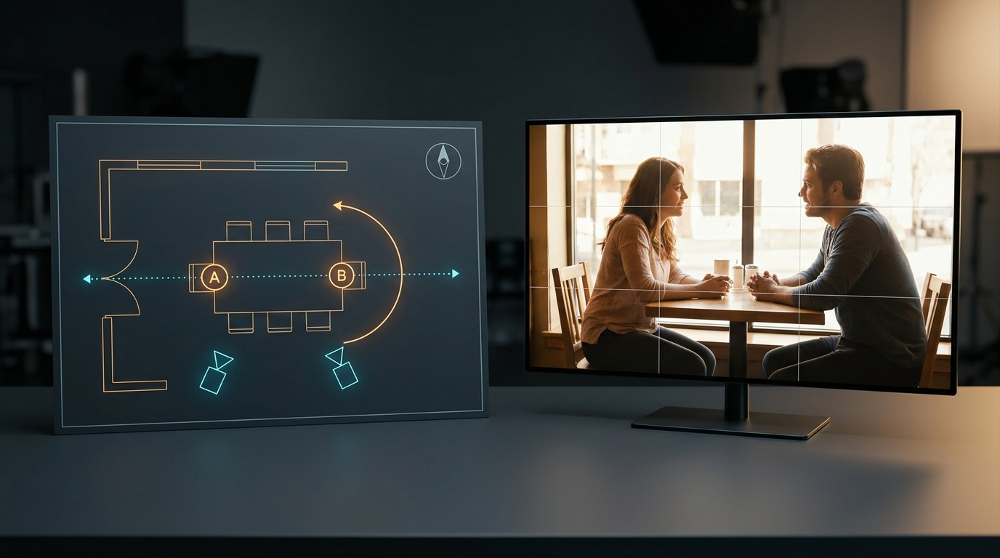
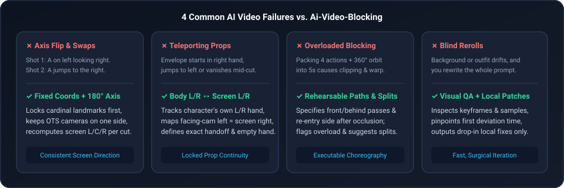
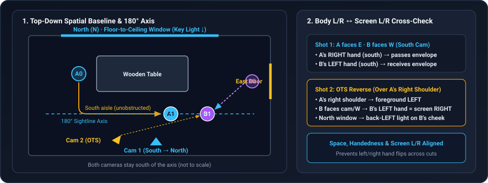
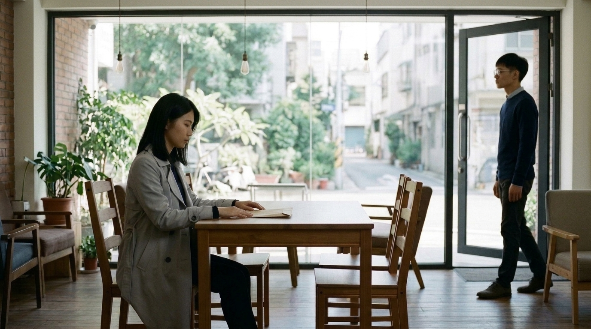
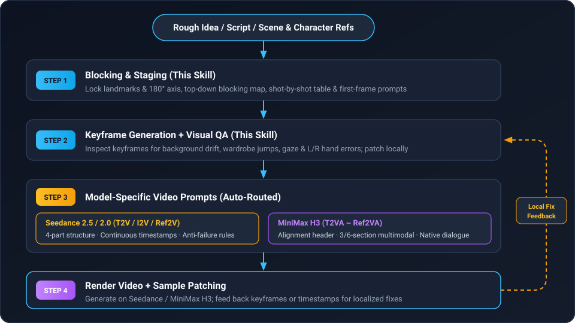

<p align="center">
  
</p>

<h1 align="center">Ai-Video-Blocking</h1>

<p align="center">
  <strong>On-Set Blocking Director + Script Supervisor + Prompt Engineer for AI Narrative Video</strong><br/>
  Turn a rough idea or script into spatially consistent blocking, 180° camera axes, first-frame image prompts, and model-ready prompts for <strong>Seedance 2.5</strong> &amp; <strong>MiniMax H3</strong>.
</p>

<p align="center">
  
  
  
  
</p>

<p align="center">
  <a href="README.md">中文</a> &nbsp;|&nbsp; <strong>English</strong>
</p>

> [!TIP]
> **🎬 Companion Advanced Skill｜Twin-Skill Workflow from Spatially Clean to True Cinema**
> - **① Spatial Foundation (This Repo)**: **Ai-Video-Blocking** — Locks landmarks, blocking paths, 180° axes, L/R hand-to-screen mapping, keyframe QA, and Seedance 2.5 / MiniMax H3 standard prompt formats.
> - **② Advanced Cinematic Upgrade**: 👉 **[Ai-Cinematic-Skill](https://github.com/demon820308/Ai-Cinematic-Skill)** — Adds 5-element scene audit, Meisner acting & FACS micro-expressions, discrete FOV optics & 60/30/10 lighting, fight/physics locks, Hell-Grind feature asset pipeline, and 15 Seedance failure rescues.
> - **How to pair**: Use **Ai-Video-Blocking** first to prevent spatial/hand/axis errors, then pass the locked blocking into **[Ai-Cinematic-Skill](https://github.com/demon820308/Ai-Cinematic-Skill)** for cinematic performance, optics, and heavy production polish (or run a `2 → 1 → 2` workflow for multi-scene films).

---

## Why This Skill?

In multi-shot AI narrative videos, the most expensive failures are rarely image quality—they are **spatial and continuity breakdowns**: characters swapping sides across cuts, mismatched eyelines in shot-reverse-shot, props teleporting between hands, or broken 180° axes.

This skill encodes real film-set discipline—fixed scene coordinates, body vs. gaze separation, left/right-hand-to-screen mapping, 180° axis tracking, and visual keyframe QA—and pairs it with native prompt rules for **Seedance 2.5** and **MiniMax H3**, taking you from a rough idea to copy-paste prompts.

<p align="center">
  
</p>

---

## What Content Formats Does It Fit Best?

Works for any visual style (live-action, 3D, 2D anime, period, sci-fi) and aspect ratio (16:9 / 9:16), as long as **characters act and move in space**:

- **AI Short Dramas / Vertical Micro-Dramas**: Two-person and multi-character scenes, confrontations, prop handoffs, shot-reverse-shot dialogue.
- **AI Narrative Animation / Motion Comics**: Repeated cuts in fixed rooms with locked wardrobe, landmarks, and prop ownership.
- **Cinematic Short Films / Thrillers**: Corridor tracking, legal axis-crossing, occlusion & re-entry, subtle reaction beats.
- **Story-Driven Commercials**: Live-action or virtual-actor product stories with continuous human interaction.
- **Narrative Music Videos**: Emotional blocking, passing-by choreography, eye-contact cutbacks.
- **Previsualization (Previs)**: Fast top-down blocking diagrams + keyframe stills to validate camera placement before heavy production.

---

## Capabilities & Boundaries

| ✅ What It Does | ❌ What It Doesn't Do |
| :--- | :--- |
| **Rough idea / script → blocking & shot splitting**: Fills in landmarks, routes, and axes (preserving user script verbatim, tagging additions as `〔体系补〕`, with orbit geometry lock & 1s position-lock wide) | **Does not render video directly**: Outputs blocking plans, prompts, and localized fixes; final video runs on Seedance / MiniMax H3 |
| **First-frame image prompts**: Static-moment framing with character L/R ↔ screen L/R cross-checks and negative constraints | **Not a full-series screenwriter**: Focuses on staging scenes cleanly, not plotting 30-episode outlines |
| **Model-specific video prompts**: Routes automatically to **Seedance 2.5/2.0** (timecoded + non-timecoded dual pass, Jimeng audio channels, dual-state ref checks) or **MiniMax H3** (`T2VA`–`Ref2VA` multimodal format) | **Cannot guarantee 100% zero-reroll perfection**: Eliminates spatial/prompt contradictions, while generative models still retain stochastic variance |
| **Visual keyframe & sample QA**: Inspects generated keyframes for background drift, wardrobe jumps, gaze errors, and hand swaps, giving sentence-level localized patch instructions | **Not for pure landscapes, static product turntables, or abstract VFX**: Use style-specific generators for non-character shots |

---

## Real End-to-End Demo (Two-Shot Café Shot-Reverse-Shot)

Both keyframes below were generated directly from this skill's Shot 1 and Shot 2 first-frame prompts, verifying **180° axis lock, character left-hand → screen lower-right mapping, and north-window lighting continuity**:

<p align="center">
  
</p>

| Shot 1 Keyframe (Medium｜South → North Establishing) | Shot 2 Keyframe (OTS Close-Up｜Over Lin Qiu's Right Shoulder) |
| :---: | :---: |
|  |  |
| **Spatial baseline**: North floor-to-ceiling window in rear, east entrance door on far right; Lin Qiu (light gray trench coat) sits on west chair facing east holding the tabletop kraft envelope; Jing Chuan (navy sweater, glasses) enters from east facing west. | **180° axis preserved**: Lin Qiu's blurred right shoulder frames foreground left; Jing Chuan sits center-right looking left; **his left hand holds the kraft envelope at lower-right**; north window light hits his right cheek from back-left. |

> **Visual QA Loop**: Feeding both keyframes back into this skill automatically caught 4 subtle continuity issues (extra chairs blocking the south aisle in Shot 1, Jing Chuan's gaze slightly too high, Shot 2's black-frame exterior door drifting into a wooden EXIT door, and Jing Chuan's shirt collar disappearing across the cut) and produced localized patch prompts before spending video credits.

---

## Quick Start

```bash
# Option 1: Install via skills CLI
npx skills add https://github.com/demon820308/Ai-Video-Blocking

# Option 2: Clone directly into your skills directory
git clone https://github.com/demon820308/Ai-Video-Blocking.git
```

Keep `SKILL.md` at the root with `references/` and `templates/` intact:

- **Antigravity**: Place the folder in `~/.gemini/config/skills/` (Windows: `C:\Users\<user>\.gemini\config\skills\`) and start a new conversation.
- **Claude Code / Cursor / Codex / other Skill-compatible agents**: Install with `npx skills add` above, or clone and import as a custom Skill.

---

## How to Use

### 1. Standard 4-Step Workflow

<p align="center">
  
</p>

### 2. Copy-Paste Input Template

```text
Please plan a [N]-shot blocking layout and image/video prompts (Mode: I2V / Ref2V / T2V, Target model: Seedance 2.5 / MiniMax H3).

[Scene & Fixed Landmarks]
(e.g., Cafe window booth, large north window, east entrance door, rectangular wooden table with west and east chairs)

[Characters & Wardrobe]
- A (Name): gender, hairstyle, clothing colors, accessories (attach reference images if available)
- B (Name): ...

[Shot-by-Shot Action, Props & Duration]
- Shot 1 (Xs, shot size): starting pose -> who moves first -> landmark route -> which hand holds/passes what prop -> ending state
- Shot 2 (Xs, shot size / OTS): continues from Shot 1 -> action & gaze shift -> final frame
```

### 3. Quick Control Commands

| Goal | Include This Phrase | Skill Behavior |
| :--- | :--- | :--- |
| Pre-check feasibility first | `Analyze first, no prompts yet` | Audits conflicts, blind spots, and risks without writing prompts |
| Force single continuous take | `Keep it as one continuous shot, do not split` | Preserves single-shot requirement, flags risk, and offers a de-risked version |
| Target model & mode | `Write for Seedance 2.5 I2V` / `Output MiniMax H3 FL2VA` | Auto-loads the matching model spec (or outputs both side-by-side) |
| Partial output only | `Top-down map and blocking routes only` / `Video prompt only` | Delivers only the requested module without full tables |
| Visual QA & local patch | `Review these keyframes for continuity and give localized fixes` | Pinpoints exact deviations and outputs drop-in replacement instructions |

---

## Repository Structure

```text
Ai-Video-Blocking/
├── SKILL.md                               # Core role, principles, progressive routing & workflow
├── README.md                              # Chinese README
├── README_EN.md                           # English README (this file)
├── assets/                                # README showcase visuals
│   ├── hero-cover.jpg
│   ├── pain-points-zh.svg / en.svg
│   ├── blocking-axis-zh.svg / en.svg
│   ├── workflow-zh.svg / en.svg
│   ├── demo-shot1-keyframe.jpg
│   └── demo-shot2-keyframe.jpg
├── references/                            # On-demand rules & model specs
│   ├── 01_人物身份与造型锁定.md             # Character identity & wardrobe lock
│   ├── 02_场景空间坐标与地标.md             # Spatial coordinates, landmarks & articulated fixture locks
│   ├── 03_走位动作与道具连续性.md           # Blocking choreography & prop continuity
│   ├── 04_摄影机与镜头轴线.md               # Camera, 180° axis & L/R-to-screen check
│   ├── 05_镜头连续性与拆镜.md               # Shot handoff & split-shot criteria
│   ├── 06_样片验收与偏差修正.md             # Sample QA, localized patching & A/V sync checks
│   ├── 07_Seedance提示词结构规范.md          # Seedance 2.5 (and 2.0) official prompt spec
│   └── 08_MiniMax_H3提示词结构规范.md        # MiniMax H3 5-mode multimodal & A/V SFX sync spec
└── templates/                             # On-demand delivery templates
    ├── 站位与走位方案模板.md
    ├── 首帧生图提示词模板.md
    ├── 视频生成提示词模板.md
    └── 样片检查表.md
```

> Note: Core instruction files (`SKILL.md`, `references/`, `templates/`) are authored in Chinese and work cleanly with modern multilingual LLMs; MiniMax H3 outputs are automatically generated in H3's required English multimodal format while preserving original-language dialogue.

---

## Changelog

- **V1.0**: Initial blocking, spatial coordinate, prop continuity, camera axis, shot-splitting, and sample QA framework.
- **V1.1**: Added progressive-disclosure routing table in `SKILL.md`; added character L/R ↔ screen L/R cross-check; focused workflow on T2V / I2V / Ref2V.
- **V1.2**: Integrated official **Seedance 2.5 (and 2.0)** and **MiniMax H3** prompt specifications, real visual showcase assets, and bilingual GitHub READMEs.
- **V1.3**: Added three-category physical sound-effect A/V sync rules (transient contact lock, continuous action start/stop lock, ambient/off-screen separation, and cross-field timeline alignment) across MiniMax H3 specs, pre-delivery rehearsal, and sample QA checklists.
- **V1.4**: Added conditional articulated-fixture constraints (single/double hinged doors, sliding doors, windows, drawers) requiring reference-image handle verification, a 3-tuple lock (handle/opening side + opposite hinge/track side + swing direction), reverse-shot scene-to-screen L/R recalculation, and swing-arc clearance across first-frame, MiniMax H3 (I2VA/FL2VA/Ref2VA), pre-delivery rehearsal, and sample QA checklists.
